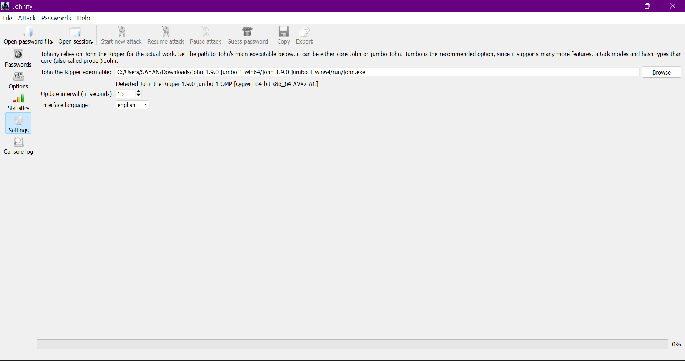
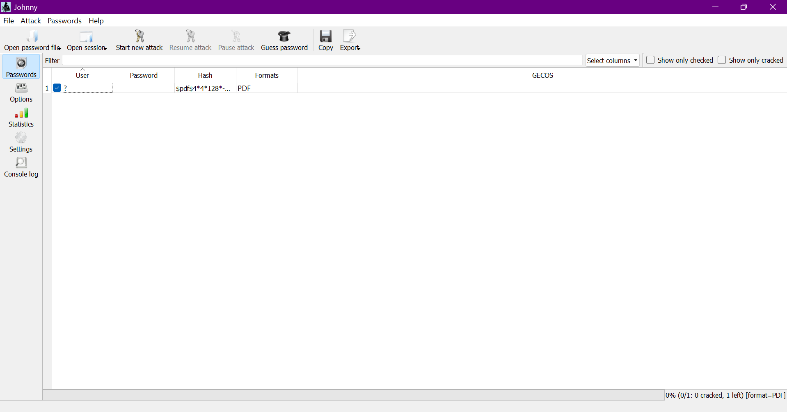
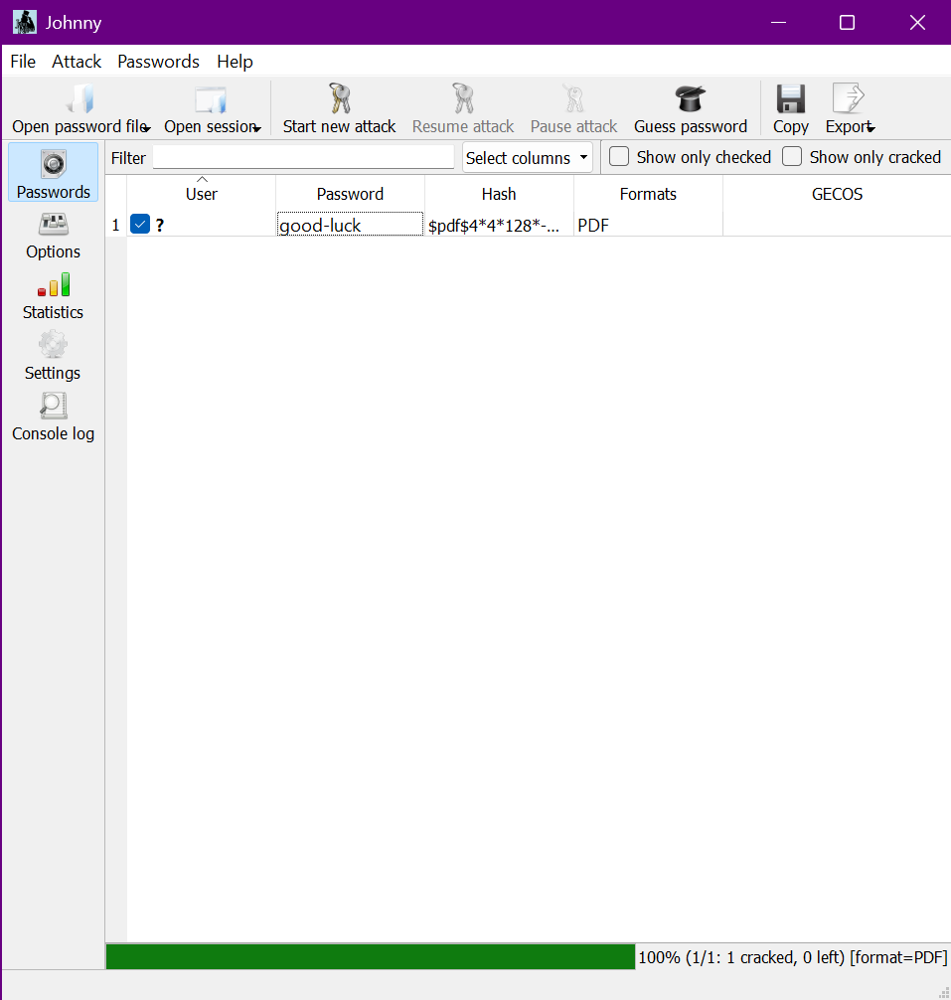
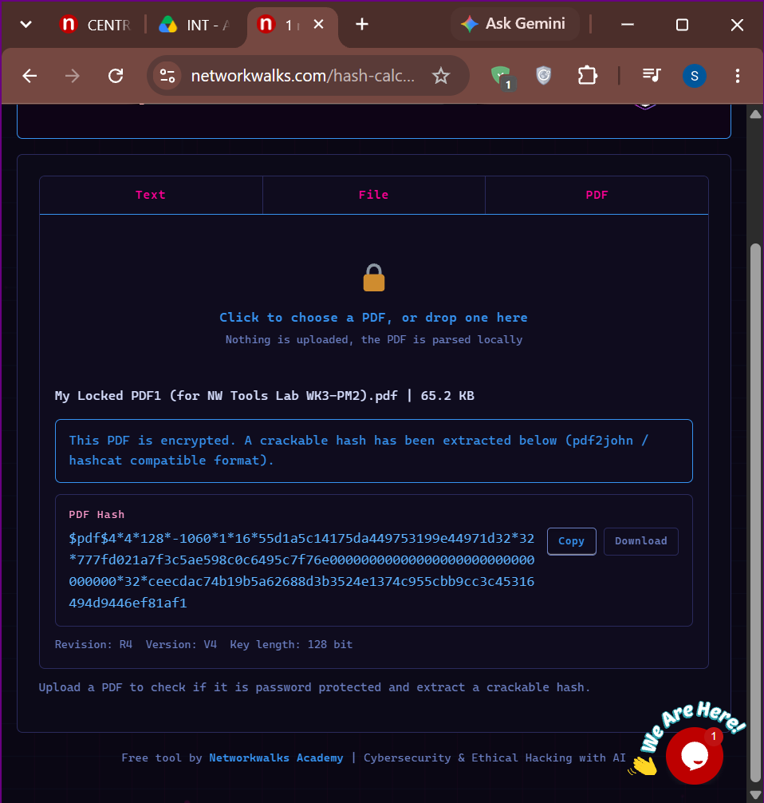
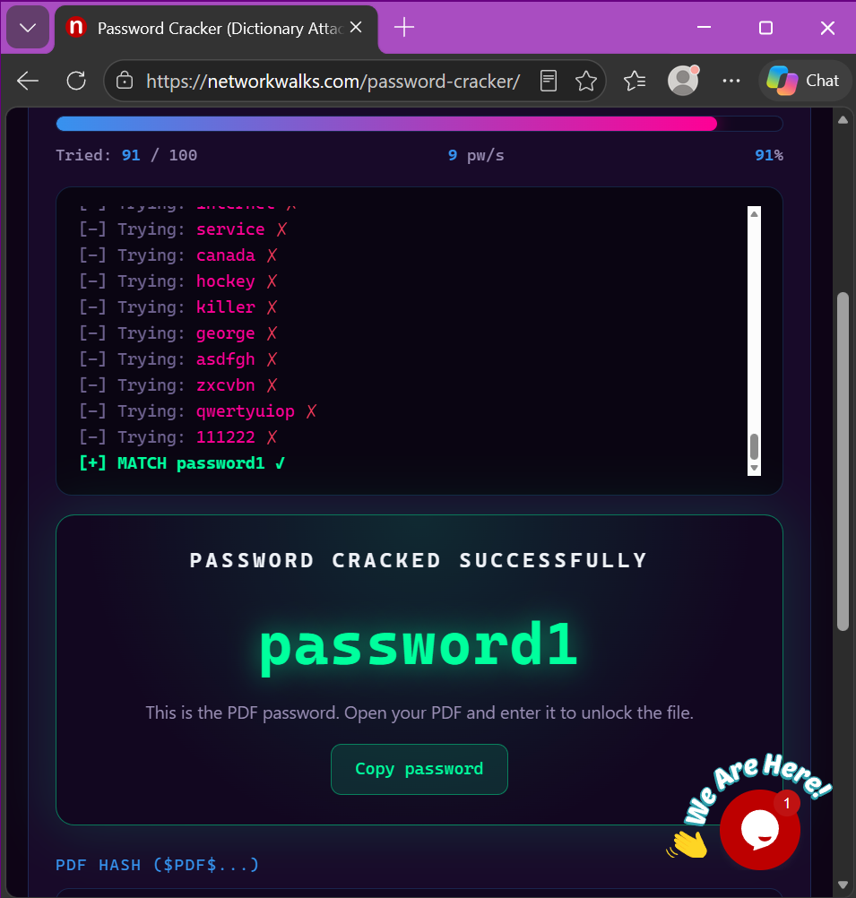

# 🔐 NETWORKWALKS — WEEK 3 CYBERSECURITY INTERNSHIP

## Password Security Assessment Using John the Ripper, Johnny GUI & Networkwalks Tools

**Internship Organization:** Networkwalks  
**Internship Domain:** Cybersecurity  
**Internship Week:** 3  
**Intern Name:** Sayan Dalal  
**Cohort ID:** B084  
**Platform:** Windows (HP Laptop)

---

## 📌 1. Introduction

During Week 3 of the Networkwalks Cybersecurity Internship, I performed practical exercises focused on password security auditing and password recovery using different tools.

The activities were divided into two project modules:

- **Project Module 1 (PM1):** Password Cracking with John the Ripper and Johnny GUI.
- **Project Module 2 (PM2):** Password Cracking with Networkwalks Tools.

Both modules involved examining password-protected PDF files supplied for internship practice, understanding password hash representations, and verifying the results of password recovery.

These exercises were performed in an authorized training environment using the provided practice files.

---

## 🎯 2. Objectives

The main objectives of this week's practical exercises were:

1. Understand password protection and password hashing concepts.
2. Learn how password-auditing tools process encrypted PDF files.
3. Install and configure John the Ripper and Johnny GUI.
4. Understand the role of password hashes in security auditing.
5. Perform password recovery demonstrations on authorized practice files.
6. Verify recovered passwords by opening the corresponding PDFs.
7. Document practical observations and results using screenshots.

---

## 🛠️ 3. Tools and Environment

| Tool | Purpose |
|---|---|
| John the Ripper | Password security auditing and recovery |
| Johnny GUI | Graphical interface for John the Ripper |
| Networkwalks Hash Calculator | Extracting password hash information |
| Networkwalks Password Cracker | Password recovery demonstration |
| Notepad | Preparing and saving extracted hash data |
| PDF Reader | Verifying access to password-protected PDFs |
| Windows | Operating system used for the practical |

---

# 🔹 PROJECT MODULE 1 (PM1)
## Password Cracking with John the Ripper and Johnny GUI

### Task 1 — Installation and Configuration

**Objective:** Install and configure John the Ripper with Johnny GUI on Windows.

**Procedure:**

1. Downloaded the Windows 64-bit version of John the Ripper from the official Openwall website.
2. Extracted the downloaded ZIP archive.
3. Located the `john.exe` executable inside the extracted `run` directory.
4. Downloaded Johnny GUI version 2.2 for Windows.
5. Extracted the Johnny archive and launched its installer.
6. Completed the installation and opened Johnny GUI.
7. Navigated to Johnny's Settings section.
8. Selected the John the Ripper executable using the Browse option.
9. Verified that Johnny successfully detected John the Ripper.

**Observation:**

Johnny successfully recognized the installed John the Ripper executable.

The detected version was **John the Ripper 1.9.0-jumbo-1**.

**Screenshot:**



---

### Task 2 — PDF Hash Preparation and Loading

**Objective:** Prepare and load the password hash of the first internship practice PDF.

**Procedure:**

1. Selected the first password-protected PDF supplied for the internship exercise.
2. Extracted its password hash.
3. Opened Notepad and pasted the extracted hash.
4. Saved the hash as `hash1.txt`.
5. Opened Johnny GUI.
6. Selected the Open Password File option.
7. Loaded `hash1.txt` into Johnny.
8. Verified that the application recognized the hash format.

**Observation:**

Johnny successfully loaded the extracted hash and identified its format as **PDF**.

The initial status displayed:

- Total hashes: 1
- Recovered passwords: 0
- Remaining: 1

**Screenshot:**



---

### Task 3 — Password Recovery Demonstration

**Objective:** Perform a password recovery demonstration using Johnny GUI and John the Ripper.

**Procedure:**

1. Opened the previously loaded PDF hash in Johnny GUI.
2. Selected the Start New Attack option.
3. Allowed the tool to perform the password-auditing operation.
4. Observed the results displayed by Johnny.
5. Confirmed that a password was successfully recovered.

**Observation:**

John the Ripper successfully recovered the password associated with the first practice PDF.

This demonstrated how password-auditing tools can test the security of password-protected documents.

**Screenshot:**



---

### Task 4 — Verification of Recovered Password

**Objective:** Verify whether the recovered password provides access to the original protected PDF.

**Procedure:**

1. Located the original password-protected PDF.
2. Opened the document using a PDF reader.
3. Entered the recovered password.
4. Verified that the PDF opened successfully.
5. Recorded the successful verification result.

**Observation:**

The recovered password was valid, and the first practice PDF opened successfully.

**Screenshot:**


---

### PM1 Result

The first password-protected PDF was successfully assessed using John the Ripper and Johnny GUI.

The exercise covered tool configuration, hash preparation, password recovery, and verification.

**Scope:** The practical demonstration was completed for the first supplied PDF. The remaining practice PDFs were not included in the completed assessment.

---

# 🔹 PROJECT MODULE 2 (PM2)
## Password Cracking with Networkwalks Tools

### Task 1 — PDF Hash Extraction

**Objective:** Extract password hash information from the Networkwalks-provided password-protected PDF.

**Procedure:**

1. Opened the Networkwalks Hash Calculator.
2. Selected the provided password-protected practice PDF.
3. Used the tool to extract the PDF password hash.
4. Observed the extracted hash information.
5. Recorded the result for documentation.

**Observation:**

The Networkwalks Hash Calculator successfully extracted password hash information from the practice PDF.

**Screenshot:**



---

### Task 2 — Password Recovery Using Networkwalks Password Cracker

**Objective:** Demonstrate password recovery using the Networkwalks Password Cracker.

**Procedure:**

1. Opened the Networkwalks Password Cracker.
2. Used the previously extracted PDF hash.
3. Performed the password recovery exercise using the tool's provided password list.
4. Observed the password matching process.
5. Recorded the successful recovery result.

**Observation:**

The password recovery demonstration was successful.

The tool identified a matching password from its built-in list of 100 candidate passwords.

The match was reported at **91 out of 100**.

**Screenshot:**



---

### Task 3 — Verification of PDF Access

**Objective:** Confirm the validity of the recovered password.

**Procedure:**

1. Located the original password-protected PDF supplied for PM2.
2. Opened the PDF using a PDF reader.
3. Entered the recovered password.
4. Verified that the document opened successfully.
5. Recorded the successful result.

**Observation:**

The recovered password successfully unlocked the provided practice PDF.

This confirmed the result obtained using the Networkwalks Password Cracker.

**Screenshot:**


---

### PM2 Result

The Networkwalks password security exercise was successfully completed.

The practical demonstrated PDF hash extraction, password recovery using a provided candidate list, and verification of the recovered password.

---

## 📊 4. Results Summary

| Module | Activity | Result |
|---|---|---|
| PM1 | John the Ripper installation | Completed |
| PM1 | Johnny GUI configuration | Completed |
| PM1 | First PDF hash preparation | Completed |
| PM1 | Password recovery demonstration | Successful |
| PM1 | First PDF verification | Successful |
| PM2 | PDF hash extraction | Successful |
| PM2 | Password recovery using Networkwalks tools | Successful |
| PM2 | PDF verification | Successful |

---

## 📚 5. Learning Outcomes

Through these practical exercises, I gained experience in:

1. **Password Security:** Understanding how passwords protect encrypted documents and why password strength matters.

2. **Password Hashes:** Learning how extracted password hash data can be used during authorized security auditing.

3. **John the Ripper:** Understanding the role of John the Ripper in password security assessment.

4. **Johnny GUI:** Learning how to configure and use a graphical interface for John the Ripper.

5. **Networkwalks Tools:** Gaining experience with the Networkwalks Hash Calculator and Password Cracker.

6. **Password Verification:** Understanding the importance of validating tool results against the original practice document.

7. **Technical Documentation:** Developing practical reporting skills through organized screenshots, observations, and results.

---

## 🔒 6. Security Considerations

Password auditing should only be performed on files and systems for which explicit authorization has been provided.

These exercises were conducted using password-protected practice files supplied for the Networkwalks internship.

The practicals also highlighted the importance of using strong, unique passwords to protect sensitive information.

Recovered passwords, extracted hashes, and protected practice documents have not been included in this public repository.

---

## 📁 7. Repository Structure

```text
NETWORKWALKS-SAYAN-B084-WK3-PM1-PM2-PASSWORD-SECURITY/
│
├── README.md
│
└── screenshots/
    ├── W3_PM1_Task1_JTR_Johnny_Configuration.png
    ├── W3_PM1_Task2_PDF1_Hash_Loaded.png
    ├── W3_PM1_Task3_PDF1_Password_Recovered.png
    ├── W3_PM1_Task4_PDF1_Successfully_Unlocked.png
    ├── W3_PM2_Task1_PDF_Hash_Extraction.png
    ├── W3_PM2_Task2_Password_Recovery_Result.png
    └── W3_PM2_Task3_PDF_Successfully_Unlocked.png
```

---

## 🏁 8. Conclusion

Week 3 of the Networkwalks Cybersecurity Internship provided practical exposure to password security auditing and recovery techniques.

Using John the Ripper, Johnny GUI, and Networkwalks tools, I learned how password hashes are processed during authorized security assessments and how recovered passwords can be verified.

The exercises strengthened my understanding of password protection, security auditing, and technical documentation.

---

**Internship:** Networkwalks Cybersecurity Internship  
**Week:** 3  
**Cohort:** B084  
**Status:** Completed Practical Exercises — PM1 (First PDF) and PM2
